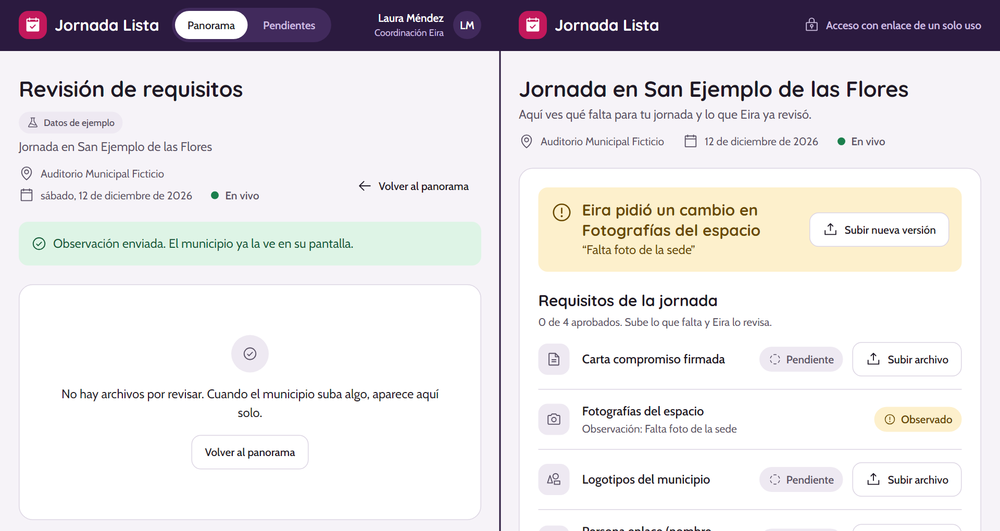

# Jornada Lista

**Cada jornada, lista a tiempo.** Un expediente por jornada para Eira y sus municipios: el municipio sube sus documentos sin contraseña y Eira ve en un semáforo qué falta y qué bloquea.

Eira × Nerdearla Vibeathon México 2026, Reto 2 (coordinación institucional, cartas compromiso y documentación). Equipo NerdHack.

**In English:** Jornada Lista gives Eira and each municipality one shared file per health campaign day. The municipality uploads its documents through a single-use link, Eira approves or asks for a change with a reason, and both screens update live. Hackathon prototype; every name and record in it is fictitious.

- Demo desplegada: https://nerdhack.onrender.com (plan gratuito: se duerme tras 15 minutos sin tráfico y tarda cerca de un minuto en despertar; al despertar los datos vuelven al estado sembrado)
- Video plan B: `demo/plan-b.webm` (56 s, grabado de la app real) · Guion de 2 minutos: `demo/guion.md`



## Qué hace

| Pantalla | Ruta | Para quién |
|---|---|---|
| Panorama con semáforo | `/panel` | Eira |
| Pendientes por municipio | `/pendientes` | Eira |
| Expediente de la jornada | `/panel/:jornada` | Eira |
| Revisión: aprobar u observar con motivo | `/panel/:jornada/revision` | Eira |
| Bitácora | `/panel/:jornada/bitacora` | Eira |
| Requisitos de la jornada y subida de archivos | `/m/:jornada` | Municipio |
| Carta compromiso con cláusulas protegidas | `/m/:jornada/carta` | Municipio |

Semáforo, calculado y nunca guardado: verde si está aprobado o faltan más de 14 días; ámbar si faltan 14 días o menos sin aprobar; rojo si faltan 7 o menos.

## Qué es real y qué está simulado

| Parte | Estado |
|---|---|
| Expediente por jornada con lista de requisitos | Implementado |
| Estados pendiente, recibido, observado y aprobado; observar exige motivo | Implementado |
| Carta desde plantilla; el servidor rechaza (422) una cláusula alterada | Implementado |
| Versiones de archivo con sha256 y bitácora de cambios | Implementado |
| Enlace de un solo uso, vence en 15 minutos | Implementado |
| Pantallas en vivo por SSE | Implementado |
| Semáforo, panorama y pendientes por municipio | Implementado |
| Envío de correo | Simulado: no sale ningún correo; el enlace se pide por API y los recordatorios quedan en la bitácora |
| Paso del tiempo | Simulado con `DEMO_CLOCK_OFFSET_DAYS` |
| Firma de la carta | Simulada: guardar no es firmar ni aprobar |
| Crear jornada y enviar el acceso desde `/panel` | Implementado; como no sale correo, el enlace se muestra en pantalla (solo demo) |
| Sesiones y roles en el servidor | Falta: la API no exige sesión; el enlace de un solo uso funciona, pero no protege las demás rutas |
| Valkey administrado, respaldos, cifrado | Diseñado, no implementado |

## Correrlo

Requiere Node 20 o más reciente (probado con 24.13.1). No necesita claves.

```bash
npm ci                      # en Windows sin Visual Studio: npm ci --ignore-scripts
npm --prefix web ci
npm --prefix web run build
SEED_DEMO=true node server/index.js    # abre http://localhost:3000
```

Para desarrollo: `node server/index.js` y, en otra terminal, `npm --prefix web run dev` (abre http://localhost:3001; `/api` va al servidor).

Variables (`.env.example`): `PORT`, `DB_PATH`, `UPLOAD_DIR`, `USE_VALKEY`, `VALKEY_URL`, `SEED_DEMO`, `DEMO_CLOCK_OFFSET_DAYS`. Con `USE_VALKEY=false` (por defecto) todo corre en memoria.

Lo mismo por API (en la app: `/panel`, Nueva jornada y Enviar acceso):

```bash
# crear una jornada ficticia
curl -X POST http://localhost:3000/api/jornadas -H 'content-type: application/json' \
  -d '{"municipio":{"nombre":"Villa Ejemplo","contacto_email":"enlace@villa-ejemplo.test"},"sede":"Casa de la Cultura","fecha":"2026-12-12","servicios":["exploración clínica"],"responsables":["Persona Demo"]}'
# pedir el enlace de un solo uso; se abre como /m/1#t=TOKEN
curl -X POST http://localhost:3000/api/magic/solicitar -H 'content-type: application/json' -d '{"jornada_id":1}'
```

Pruebas: `npm test` (servidor), `npm --prefix web test -- --run` (front) y `bash .uak/bin/smoke`.

## Arquitectura

Node + Express 5 + SQLite (better-sqlite3) + SSE. Valkey es opcional y solo para lo temporal (enlace de un solo uso, pub/sub, recordatorios). Front: Vite + React + TypeScript + Tailwind 4, servido por el mismo proceso desde `web/dist`. Despliegue: un servicio web en Render que se reconstruye con cada merge a `main`. No hay modelo de lenguaje en el producto.

## Privacidad

- No guarda datos clínicos: solo documentos de coordinación.
- El enlace de acceso es de un solo uso y vence en 15 minutos; se guarda su hash, no el token.
- Cada archivo queda con versión y sha256; nada se sobrescribe. La bitácora registra quién hizo qué y cuándo.
- Para un piloto real faltan: control de acceso por rol en el servidor, Postgres con respaldo probado, almacenamiento cifrado, un proveedor de correo con acuerdo de datos, política de retención y revisión legal.

## Datos, fuentes y licencias

- Municipios, sedes y personas son ficticios (`schemas/demo.json`, `demo_data: true`).
- "Más de 51,000 personas beneficiadas a septiembre de 2026 (acumulado, no pacientes únicos)" y "hoy se usa Excel o Sheets; el mayor problema son los retrasos": guía oficial del Vibeathon.
- Tipografías Quicksand y Cabin (OFL-1.1); íconos Phosphor, React, Express y better-sqlite3 (MIT).
